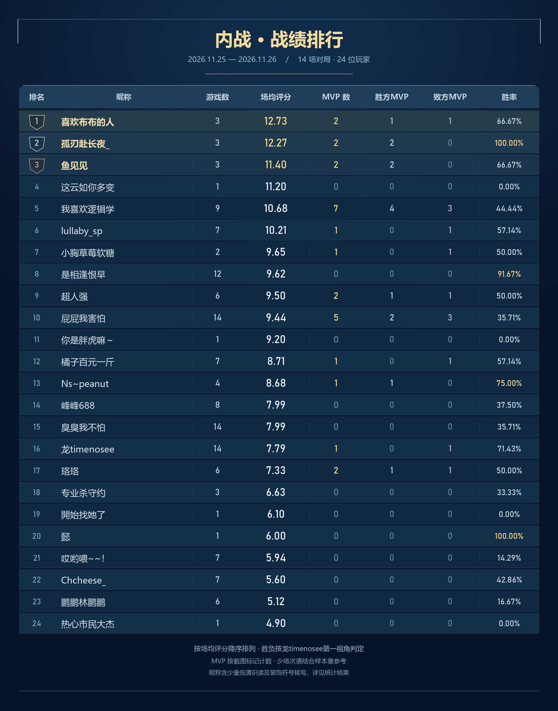

# 毛大校友群王者荣耀内战

记录毛大校友群王者荣耀内战的对局战绩，汇总每位玩家的出场次数、场均评分、MVP 和胜率，方便群友查看与回顾。

本期统计覆盖 **2026 年 11 月 25 日至 26 日**，共 **14 场对局、24 位玩家、140 条玩家出场记录**。数据来自仓库中的 14 张战绩截图，已按截图内的完整日期与时间核对，14 场均为独立对局。

## 战绩排行榜

按场均评分降序排列，展示排名、昵称、游戏数、场均评分、MVP 数、胜方 MVP、败方 MVP 和胜率。

[查看高清原图](内战战绩排行榜.png) · [查看完整统计结果](统计结果.md) · [下载玩家排名 CSV](玩家排名.csv)

## 统计口径

### 对局与胜负

- 使用截图左上角的完整日期与时间识别对局，并记录时长辅助核对。
- 全部截图均以 **龙timenosee** 为第一视角。
- 顶部显示“胜利”时，龙timenosee 所在队伍的 5 名玩家均计为获胜。
- 顶部显示“失败”时，另一队伍的 5 名玩家均计为获胜。

### 玩家指标

| 指标 | 计算方式 |
| --- | --- |
| 游戏数 | 玩家在本批次独立对局中的出场次数 |
| 场均评分 | 玩家全部出场评分之和 ÷ 游戏数 |
| MVP 数 | 玩家在截图中获得 MVP 标记的总次数 |
| 胜方 MVP | 玩家获胜且获得 MVP 标记的次数 |
| 败方 MVP | 玩家战败且获得 MVP 标记的次数 |
| 胜率 | 胜场 ÷ 游戏数 × 100% |
| MVP 率 | MVP 数 ÷ 游戏数 × 100% |
| 评分标准差 | 玩家本批次评分的总体标准差，用于观察评分波动 |

排名使用未四舍五入的场均评分，同分时依次按 MVP 率、游戏数降序排列。榜单包含全部出场玩家，比较表现时请结合游戏数解读。

2026 年 11 月 26 日 22:58 的截图中，败方未显示 MVP 标记，该局败方 MVP 计为 0。本批次共记录 **27 次 MVP，其中胜方 14 次、败方 13 次**。

## 文件说明

| 文件 | 内容 |
| --- | --- |
| [内战战绩排行榜.png](内战战绩排行榜.png) | 深蓝金色风格的完整排行榜图片，尺寸为 2200 × 2800 |
| [统计结果.md](统计结果.md) | 完整排名、对局唯一性核对及识别说明 |
| [玩家排名.csv](玩家排名.csv) | 玩家汇总数据，包含胜场、MVP 率、最高评分、最低评分与评分标准差 |
| [玩家逐局明细.csv](玩家逐局明细.csv) | 140 条玩家记录，包含图片编号、日期、时间、阵营、昵称、评分、胜负和 MVP 标记 |
| [对局识别.csv](对局识别.csv) | 14 场对局的原始识读数据及第一视角、顶部结果、所在阵营和胜方 |
| [排行榜设计说明.md](排行榜设计说明.md) | 排行榜图片的视觉设计说明 |
| `微信图片_*.jpg` | 14 张原始战绩截图，用于核对数据 |

可直接在 GitHub 浏览图片与统计文档，也可下载 CSV，用 Excel 或其他表格工具筛选、核对数据。CSV 中的胜率与 MVP 率以小数保存，例如 `0.7500` 表示 75%。

## 识别说明

昵称与评分按截图人工识读，同一固定昵称跨图归并。部分昵称的装饰符号使用可读字符转写。

“懿”“这云如你多变”“小胸草莓软糖”“鹏鹏林鹏鹏”等昵称存在低清识读不确定性，具体说明见统计结果文档。核对或补充数据时，可通过逐局明细中的图片编号、日期和时间定位原始截图。
